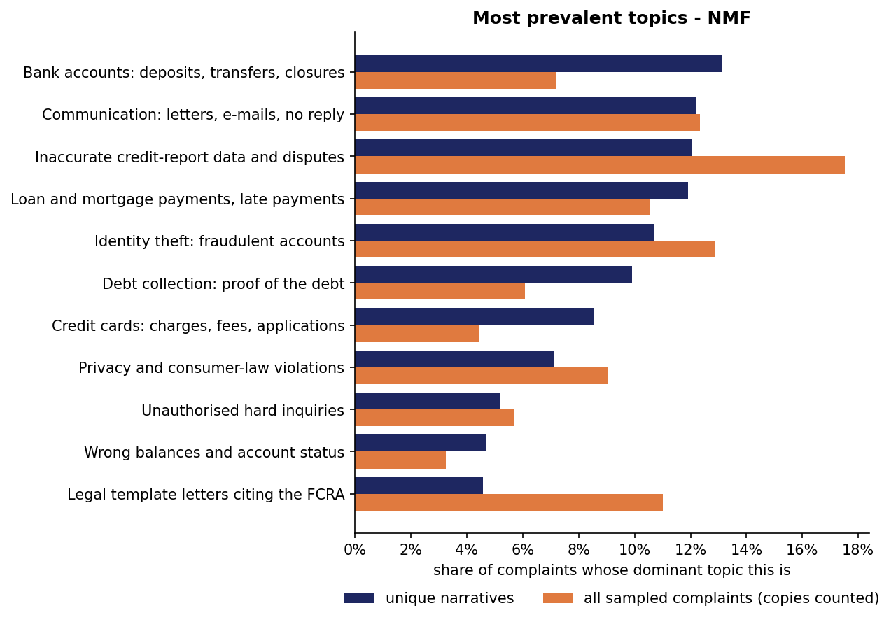
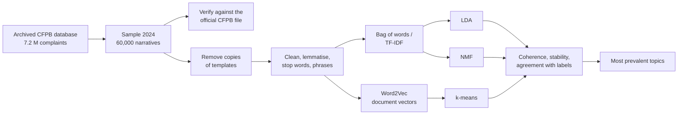

# What do complainants write about? Topic analysis of complaint narratives

An NLP pipeline that extracts the **most frequently raised topics** from a large collection of
unstructured complaints, so that decision-makers can see at a glance what people complain
about. It is developed on consumer complaints to the US Consumer Financial Protection Bureau
(CFPB), as a stand-in for the written complaints a municipality receives online.

> Portfolio project for the course *Project: Data Analysis* (CSEBDSEDA02), IU International
> University of Applied Sciences. Author: Om Jayeshkumar Prajapati.

## Results at a glance



The eleven NMF topics found in 26,727 unique complaint narratives from 2024, ranked by how
often each is a complaint's dominant topic:

| Rank | Topic (human label) | Unique narratives | All complaints, copies counted |
|---|---|---|---|
| 1 | Bank accounts: deposits, transfers, closures | 13.1% | 7.2% |
| 2 | Communication: letters, e-mails, no reply | 12.2% | 12.3% |
| 3 | Inaccurate credit-report data and disputes | 12.0% | 17.5% |
| 4 | Loan and mortgage payments, late payments | 11.9% | 10.6% |
| 5 | Identity theft: fraudulent accounts | 10.7% | 12.9% |
| 6 | Debt collection: proof of the debt | 9.9% | 6.1% |
| 7 | Credit cards: charges, fees, applications | 8.5% | 4.4% |
| 8 | Privacy and consumer-law violations | 7.1% | 9.1% |
| 9 | Unauthorised hard inquiries | 5.2% | 5.7% |
| 10 | Wrong balances and account status | 4.7% | 3.2% |
| 11 | Legal template letters citing the FCRA | 4.6% | 11.0% |

**Main findings**

* **Half of the complaints are copies.** 50.8% of the sampled narratives are exact or
  near-identical copies of another one: letter templates, mostly in credit reporting (61% of
  that product). The largest template appears 3,004 times in a sample of 60,000.
* **Counting copies would mislead decision-makers.** With copies counted, legal template
  letters jump from 4.6% to 11.0% and become a top-five topic, while everyday problems with
  bank accounts (13.1% → 7.2%) and credit cards (8.5% → 4.4%) fall by roughly half. Removing
  copies is what makes the ranking reflect distinct concerns.
* **The second most common topic is not about a product at all.** "Communication: letters,
  e-mails, no reply" is about companies that do not answer, and it spans credit reporting
  (56%) and debt collection (19%). For an organisation that receives complaints, this is the
  most directly actionable result.
* **NMF gave the clearest topics.** NMF reached C_v coherence 0.65 against LDA's 0.61, its
  topics overlap less (diversity 0.86 vs 0.73), and they come back far more reliably with
  other random seeds (0.72 vs 0.40).
* **Both representations capture topical structure.** A complaint's 10 nearest neighbours
  share its CFPB product 57% (TF-IDF) and 62% (Word2Vec) of the time, against 12.5% by chance.

Full tables and figures: [`results/RESULTS.md`](results/RESULTS.md).

## Pipeline



| Step | Module | What it does |
|---|---|---|
| 1. data | `pipeline/data.py` | downloads a pinned archived copy of the CFPB database, draws a reproducible random sample of 2024 complaints, verifies it against the current official file and removes exact and near-identical copies |
| 2. preprocess | `pipeline/preprocess.py` | removes redactions and noise, lemmatises with spaCy, keeps content words, removes stop words, joins frequent phrases |
| 3. vectorize | `pipeline/vectorize.py` | builds bag-of-words/TF-IDF and Word2Vec representations and compares them |
| 4. topics | `pipeline/topics.py` | sweeps LDA and NMF over 5–20 topics, selects k by C_v coherence, fits the final models, clusters the Word2Vec vectors, measures stability |
| 5. evaluate | `pipeline/evaluate.py` | coherence, diversity, agreement with the CFPB labels and between methods, interactive LDA view |
| 6. report | `pipeline/report.py` | figures and [`results/RESULTS.md`](results/RESULTS.md) |

Every step and decision is explained in [`docs/WALKTHROUGH.md`](docs/WALKTHROUGH.md).

## How to run it

Requirements: Python 3.9–3.12, about 4 GB of free disk space and an internet connection for
the first run. Tested with Python 3.9.6 on macOS (Apple silicon, 8 GB RAM).

```bash
git clone https://github.com/buildingzabhla/citizen-complaint-topics.git
cd citizen-complaint-topics
python3 -m venv .venv
source .venv/bin/activate            # Windows: .venv\Scripts\activate
pip install -r requirements.txt      # includes the spaCy English model
python run.py                        # all steps, about 20 minutes
python -m pytest                     # unit tests
```

The first run downloads the archived database (1.4 GB, checked against
`data/snapshot_manifest.json`) and the current official CFPB file (335 MB) into `data/raw/`.

Single steps can be repeated without redoing the earlier ones, because every step stores its
output:

```bash
python run.py --steps topics,evaluate,report
```

All parameters (time window, sample size, seed, thresholds, range of k, model settings) are in
[`config.yaml`](config.yaml). With the same configuration every result is identical on every
run. This was verified by running the whole pipeline again from a fresh clone: only the
timings and the internal element IDs of the pyLDAvis page differed. LDA is fitted
single-process for this reason. Multicore LDA was tried first and varied between runs enough
to change which number of topics scored best.

| Step | Runtime on the reference machine |
|---|---|
| data | 1.5 min (plus the downloads on the first run) |
| preprocess | 2.6 min |
| vectorize | 1.4 min |
| topics | about 14 min (the coherence sweep is cached and reused afterwards) |
| evaluate and report | under 1 min |

## Repository structure

```
├── run.py                  # runs the pipeline (all or selected steps)
├── config.yaml             # every parameter of the analysis
├── requirements.txt        # pinned environment
├── pipeline/               # one module per step (see table above)
├── tests/                  # unit tests (pytest)
├── data/
│   ├── README.md           # source, verification, sampling, licence
│   ├── snapshot_manifest.json   # SHA-256 of the archived files
│   └── sample_complaint_ids.csv # the exact sample, with duplicate flags
├── results/
│   ├── RESULTS.md          # all key tables and figures
│   ├── topic_labels.yaml   # human labels for the topics
│   ├── lda_visualisation.html   # interactive LDA view (pyLDAvis)
│   ├── figures/
│   └── tables/
└── docs/WALKTHROUGH.md     # explanation of every step and decision
```

Raw and intermediate data (`data/raw/`, `data/interim/`) are not stored in the repository; the
pipeline downloads or recreates them.

## Discussion

**Data.** The planned source had to change during implementation: the CFPB no longer
publishes complaint narratives. The pipeline uses an archived copy of the official database
instead and verifies it against the current official file. Of the sampled complaints, 99.7%
are still listed there, with identical dates, products and issues. The second data problem
was more interesting: half of all narratives are copies, which is exactly the
"few heavy users" distortion that a municipality would face with its own complaint system.

**Choices that changed during development.** The 20-token minimum from the concept removed
27% of the documents, and removed them unevenly between products, so it was lowered to 10.
LDA was first fitted with gensim's multicore implementation, which turned out not to be
reproducible: a second run moved its coherence scores by up to 0.018 and changed the best
number of topics from 5 to 15. All LDA models are therefore fitted single-process. With that,
coherence peaks at k = 17 (C_v 0.606), and reading the 17 topics confirmed the choice. Both
changes are explained in [`docs/WALKTHROUGH.md`](docs/WALKTHROUGH.md).

**Models.** NMF produced sharper, more distinct and more stable topics than LDA on these
short, repetitive texts, so its topics are the main result. k-means on Word2Vec vectors
finds a similar structure (NMI 0.37 with NMF, 0.47 with LDA) and scores well on coherence,
but gives every complaint exactly one cluster. Topics agree only moderately with the CFPB's
product labels (NMI 0.20–0.28). That is expected: several topics, such as unanswered letters
or identity theft, cut across products.

**Limitations.** The texts are US financial complaints, not municipal ones: the method carries
over, the topics do not. Only complaints whose authors agreed to publication are included.
Collapsing templates counts a template once, even if several people used it for genuine
problems; the second prevalence column shows the size of that effect. Assigning one dominant
topic per complaint simplifies complaints that mix several concerns. Small preprocessing
imperfections remain: spaCy's small model keeps *bureau* and *bureaus* apart, and the phrase
detector does not join very frequent pairs such as *credit report*.

**Outlook.** For a German municipality the pipeline would need a German spaCy model and stop
word list. Monthly topic shares would show which concerns are rising, and transformer-based
embeddings (e.g. BERTopic) could be compared with the two representations used here. Once
topics are labelled, a supervised classifier could route new complaints automatically.

## Data source and licence

Consumer Complaint Database, US Consumer Financial Protection Bureau (public domain), via the
archived copy [`davidheineman/consumer-finance-complaints-large`](https://huggingface.co/datasets/davidheineman/consumer-finance-complaints-large)
(revision `44cfa17`, snapshot of 2 January 2025). Details in [`data/README.md`](data/README.md).
