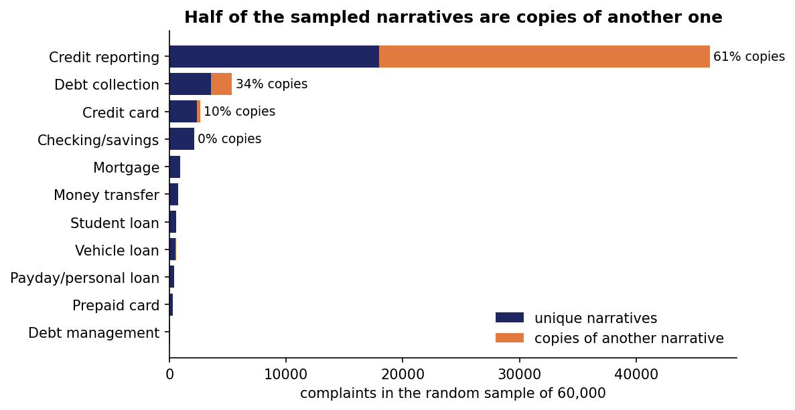
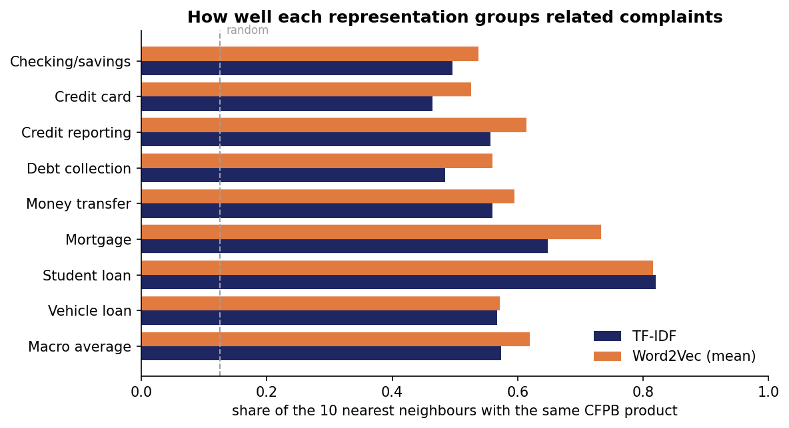
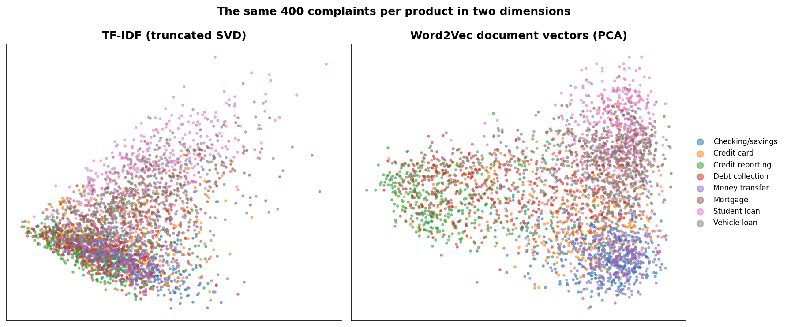
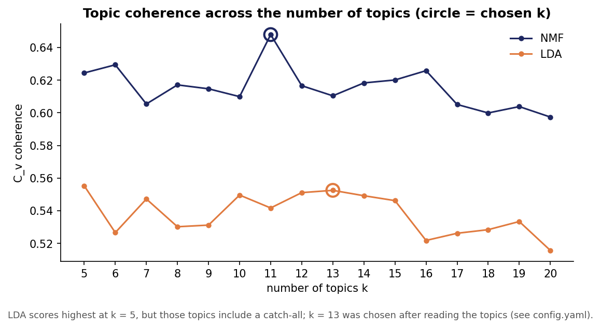
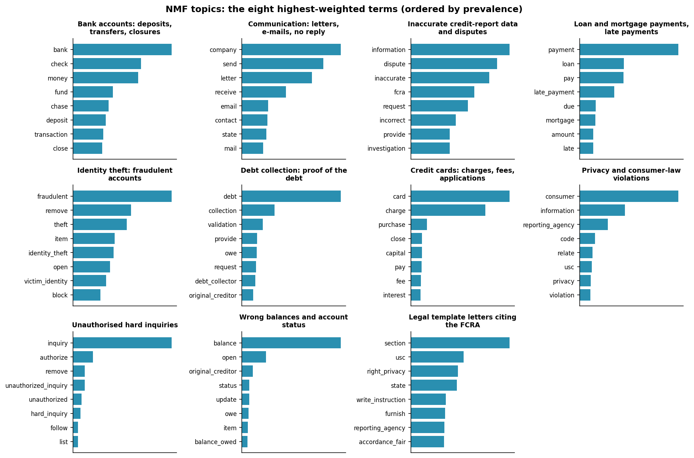
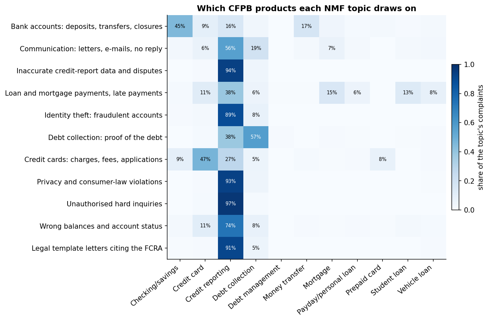
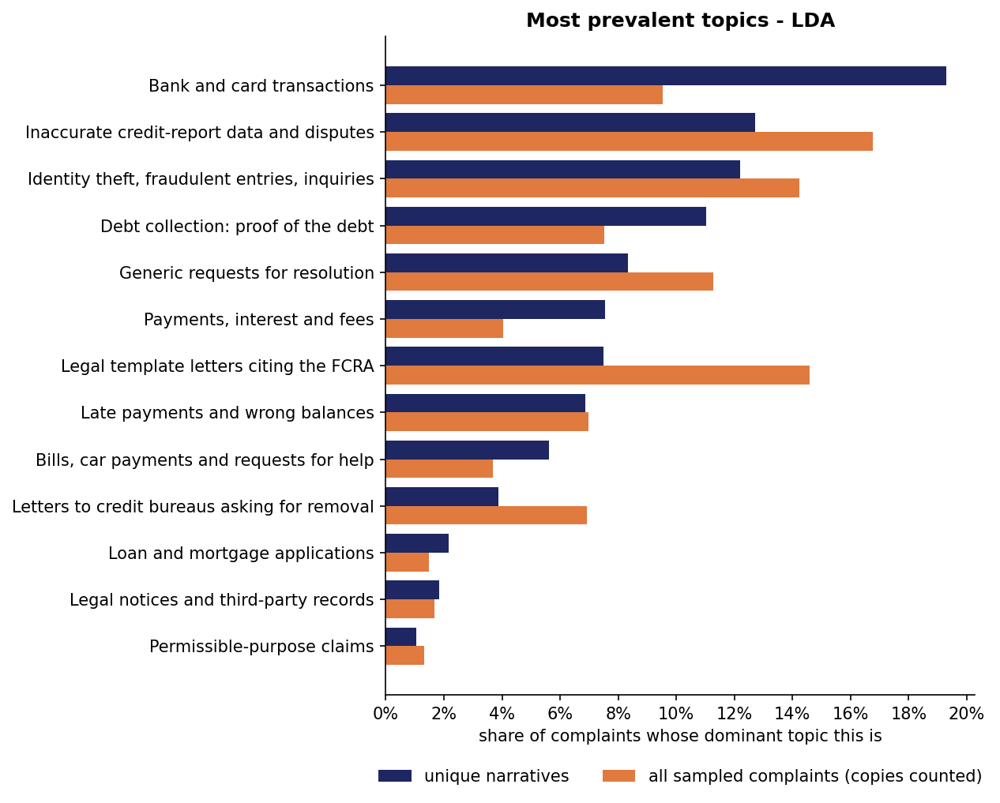

# Results

_This page is generated by `python run.py --steps report`. All numbers come from the tables in `results/tables/`; topic labels are a human reading of the top words (`results/topic_labels.yaml`)._

## 1. Data

| Stage | Complaints |
|---|---|
| Complaints in the archived database (to 2 Jan 2025) | 7,179,332 |
| Received 2024-01-01 to 2024-12-31 | 2,671,440 |
| ... with a published narrative | 680,980 |
| Random sample (seed 42) | 60,000 |
| Unique narratives after removing copies | 29,538 |
| Documents with at least 10 tokens (analysed) | 26,727 |

**Verification against the current official CFPB file:** 59,834 of 60,000 sampled complaints (99.7%) are still listed there. Of those, the date matches for 100.0%, the product for 100.0%, the issue for 100.0% and the company for 99.0%.

**Copies:** 30,462 of 60,000 sampled narratives (50.8%) are exact or near-identical copies of another sampled narrative, almost all of them credit-reporting and debt-collection templates.

## 2. Vectorisation: TF-IDF compared with Word2Vec

| representation | dimensions | non_zero_share | memory_mb | build_seconds | interpretable_dimensions | neighbour_agreement_macro |
|---|---|---|---|---|---|---|
| TF-IDF (bag of words) | 5653 | 0.00729 | 13.3 | 0.9 | yes (one per term) | 0.574 |
| Word2Vec (mean of word vectors) | 100 | 1.0 | 10.7 | 77.5 | no | 0.619 |

Nearest words in the Word2Vec space:

| word | nearest_words |
|---|---|
| mortgage | specialized_loan (0.72), mortage (0.70), crosscountry (0.70), homeowners (0.69), haf (0.69), nationstar (0.69) |
| fraud | detection (0.61), fraudulent_activity (0.60), idenity (0.60), mellon (0.59), thief (0.58), perpetrator (0.58) |
| dispute | disputed (0.67), disputes (0.63), reinvestigation (0.59), investigation (0.58), transuion (0.58), detailed_description (0.57) |
| collection | attempt_collect (0.64), allied (0.63), aargon (0.62), collections (0.62), wakefield_associates (0.61), aged (0.59) |
| refund | refunded (0.76), reimburse (0.75), overpayment (0.64), morgan (0.64), backdate (0.63), chargeback (0.63) |
| identity_theft | theft (0.72), theft_affidavit (0.67), victim_identity (0.64), idenity (0.62), identity (0.61), criminal_complaint (0.60) |

## 3. Choosing the number of topics

Chosen: **LDA k = 13**, **NMF k = 11**.

## 4. The most prevalent topics

### NMF (k = 11)

| Rank | Topic | Top words | Unique narratives | With copies | C_v |
|---|---|---|---|---|---|
| 1 | Bank accounts: deposits, transfers, closures | bank, check, money, fund, chase, deposit, transaction, close, transfer, claim | 13.1% | 7.2% | 0.691 |
| 2 | Communication: letters, e-mails, no reply | company, send, letter, receive, email, contact, state, mail, response, address | 12.2% | 12.3% | 0.602 |
| 3 | Inaccurate credit-report data and disputes | information, dispute, inaccurate, fcra, request, incorrect, provide, investigation, inaccuracy, correct | 12.0% | 17.5% | 0.638 |
| 4 | Loan and mortgage payments, late payments | payment, loan, pay, late_payment, due, mortgage, amount, late, show, interest | 11.9% | 10.6% | 0.631 |
| 5 | Identity theft: fraudulent accounts | fraudulent, remove, theft, item, identity_theft, open, victim_identity, block, file, ftc | 10.7% | 12.9% | 0.72 |
| 6 | Debt collection: proof of the debt | debt, collection, validation, provide, owe, request, debt_collector, original_creditor, agency, proof | 9.9% | 6.1% | 0.661 |
| 7 | Credit cards: charges, fees, applications | card, charge, purchase, close, capital, pay, fee, interest, fraud, new | 8.5% | 4.4% | 0.554 |
| 8 | Privacy and consumer-law violations | consumer, information, reporting_agency, code, relate, usc, privacy, violation, law, financial_institution | 7.1% | 9.1% | 0.691 |
| 9 | Unauthorised hard inquiries | inquiry, authorize, remove, unauthorized_inquiry, unauthorized, hard_inquiry, follow, list, removal, unauthorized_hard | 5.2% | 5.7% | 0.635 |
| 10 | Wrong balances and account status | balance, open, original_creditor, status, update, owe, item, balance_owed, show, close | 4.7% | 3.2% | 0.555 |
| 11 | Legal template letters citing the FCRA | section, usc, right_privacy, state, write_instruction, furnish, reporting_agency, accordance_fair, violate_right, reporting_act | 4.6% | 11.0% | 0.772 |

### LDA (k = 13)

| Rank | Topic | Top words | Unique narratives | With copies | C_v |
|---|---|---|---|---|---|
| 1 | Bank and card transactions | bank, card, check, receive, money, email, send, transaction, phone, fund | 19.3% | 9.5% | 0.665 |
| 2 | Inaccurate credit-report data and disputes | information, dispute, fcra, inaccurate, consumer, request, provide, verify, reporting_act, investigation | 12.7% | 16.8% | 0.627 |
| 3 | Identity theft, fraudulent entries, inquiries | inquiry, fraudulent, remove, item, identity_theft, theft, information, file, open, address | 12.2% | 14.2% | 0.572 |
| 4 | Debt collection: proof of the debt | debt, collection, provide, request, letter, proof, dispute, receive, send, validation | 11.0% | 7.5% | 0.573 |
| 5 | Generic requests for resolution | request, issue, matter, financial, action, complaint, provide, address, concern, write | 8.3% | 11.3% | 0.512 |
| 6 | Payments, interest and fees | payment, pay, amount, charge, card, balance, interest, fee, statement, receive | 7.5% | 4.0% | 0.646 |
| 7 | Legal template letters citing the FCRA | consumer, information, usc, reporting_agency, section, state, furnish, violation, code, privacy | 7.5% | 14.6% | 0.672 |
| 8 | Late payments and wrong balances | balance, late_payment, open, payment, charge, status, update, remove, inaccurate, correct | 6.9% | 7.0% | 0.62 |
| 9 | Bills, car payments and requests for help | pay, company, work, help, car, send, money, contact, state, bill | 5.6% | 3.7% | 0.595 |
| 10 | Letters to credit bureaus asking for removal | company, send, experian, remove, information, letter, file, show, contact, complaint | 3.9% | 6.9% | 0.472 |
| 11 | Loan and mortgage applications | loan, mortgage, application, lender, insurance, apply, state, document, home, vehicle | 2.2% | 1.5% | 0.58 |
| 12 | Legal notices and third-party records | consumer, information, person, notice, act, provide, party, record, code, require | 1.8% | 1.7% | 0.497 |
| 13 | Permissible-purpose claims | consumer, delete, permissible_purpose, claim, reporting, law, provide, proof, violation, purpose | 1.0% | 1.3% | 0.493 |

An interactive view of the LDA model: [`lda_visualisation.html`](lda_visualisation.html) (download and open in a browser).

### k-means on the Word2Vec document vectors (k = 11)

| Rank | Topic | Top words | Unique narratives | With copies | C_v |
|---|---|---|---|---|---|
| 1 | Inaccurate credit-report data and disputes | information, fcra, inaccurate, dispute, fair, request, verify, reporting_act, incorrect, investigation | 15.5% | 20.2% | 0.658 |
| 2 | Bank accounts and transactions | bank, money, card, check, fund, transaction, chase, deposit, close, transfer | 14.7% | 7.2% | 0.723 |
| 3 | Identity theft and hard inquiries | inquiry, fraudulent, remove, theft, authorize, victim_identity, identity_theft, hard_inquiry, ftc, result_identity | 10.4% | 12.8% | 0.73 |
| 4 | Cards, scores and applications (mixed) | card, company, score, open, send, contact, letter, fraud, police, apply | 9.8% | 9.7% | 0.45 |
| 5 | Mortgages, car loans and property | loan, mortgage, pay, car, vehicle, home, work, insurance, payment, property | 8.8% | 4.4% | 0.676 |
| 6 | Wrong balances, late payments, billing errors | balance, late_payment, update, open, payment, show, status, late, charge, billing_error | 7.6% | 6.5% | 0.651 |
| 7 | Debt collection: proof of the debt | debt, collection, validation, debt_collector, owe, proof, provide, contract, request, allege_debt | 7.3% | 4.4% | 0.688 |
| 8 | Payments, interest and fees | payment, pay, loan, interest, charge, balance, fee, amount, due, late_fee | 7.1% | 3.8% | 0.711 |
| 9 | Legal template letters citing the FCRA | consumer, reporting_agency, section, information, usc, furnish, right_privacy, state, write_instruction, relate | 6.7% | 15.4% | 0.742 |
| 10 | Template on distress and resolution | issue, financial, matter, cause_significant, fraudulent, distress, inaccuracy, error, resolution, address | 6.6% | 11.1% | 0.579 |
| 11 | Privacy and opt-out rights | consumer, privacy, information, violation, usc, opt, act, law, right, code | 5.5% | 4.6% | 0.648 |

## 5. Quality and agreement

| method | topics | mean_c_v | diversity_top10 | stability_jaccard |
|---|---|---|---|---|
| LDA | 13 | 0.579 | 0.692 | 0.478 |
| NMF | 11 | 0.65 | 0.855 | 0.715 |
| k-means on Word2Vec | 11 | 0.66 | 0.873 | nan |

Agreement of each method's topic assignment with the CFPB labels (never seen by the models):

| method | topics | nmi_product | ari_product | nmi_issue |
|---|---|---|---|---|
| LDA | 13 | 0.231 | 0.07 | 0.214 |
| NMF | 11 | 0.228 | 0.062 | 0.204 |
| k-means on Word2Vec | 11 | 0.277 | 0.101 | 0.252 |

Agreement between the methods (NMI):

| method | LDA | NMF | k-means on Word2Vec |
|---|---|---|---|
| LDA | 1.0 | 0.343 | 0.517 |
| NMF | 0.343 | 1.0 | 0.369 |
| k-means on Word2Vec | 0.517 | 0.369 | 1.0 |
